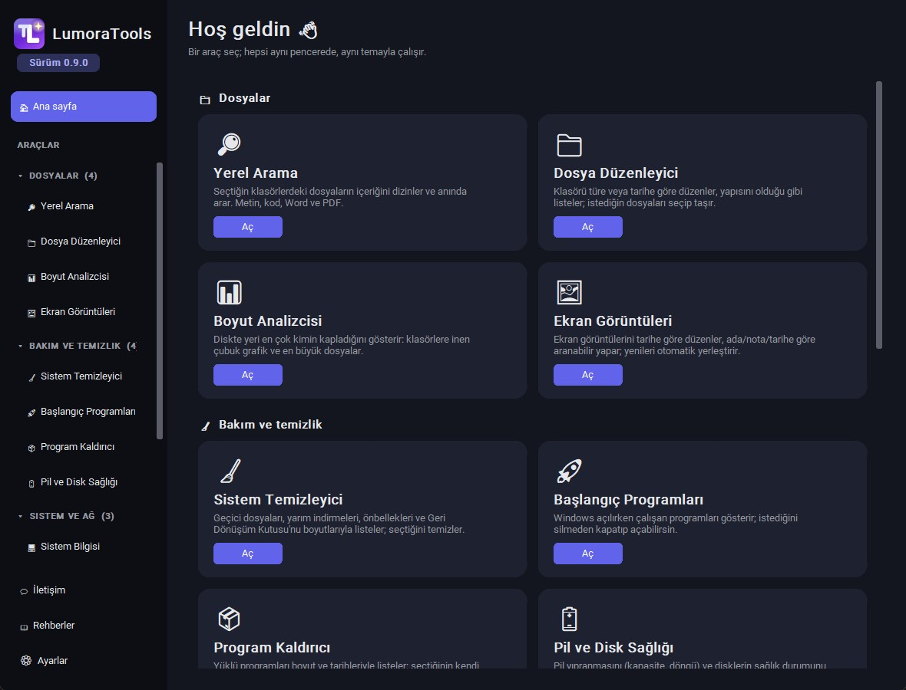
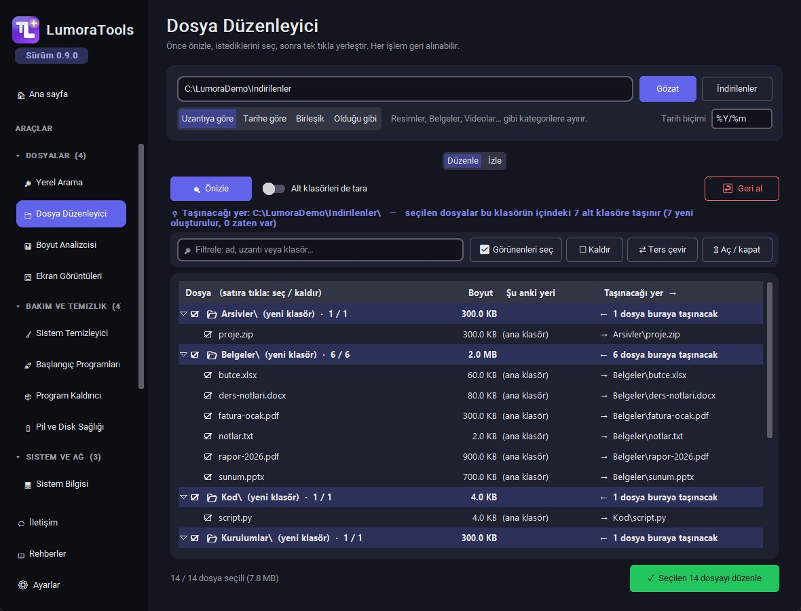
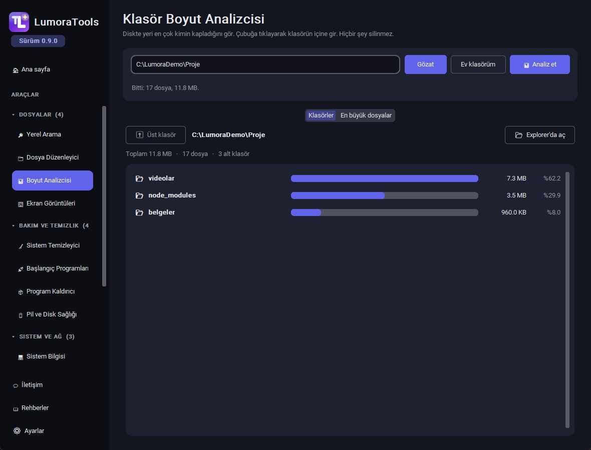
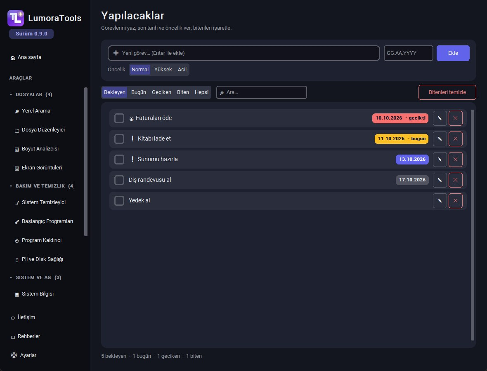
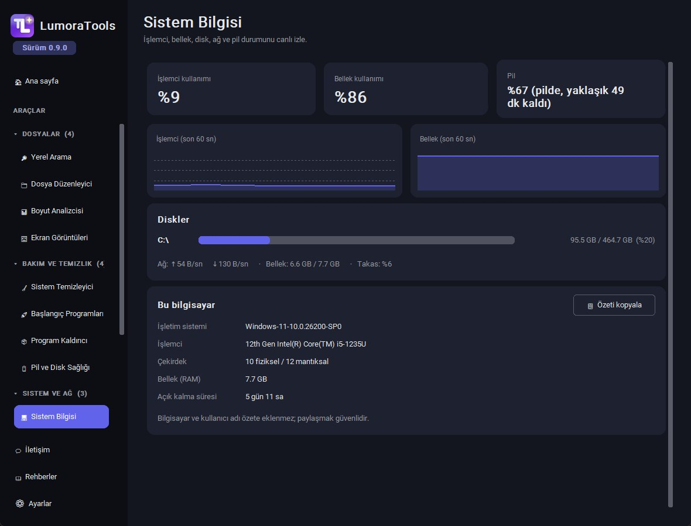
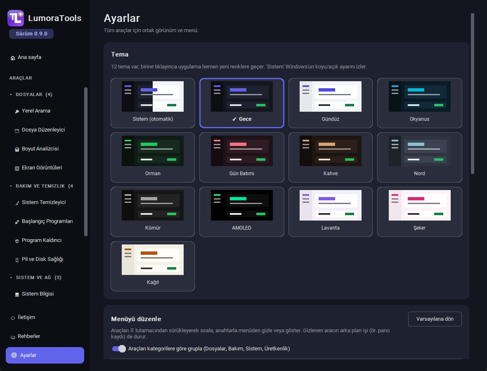
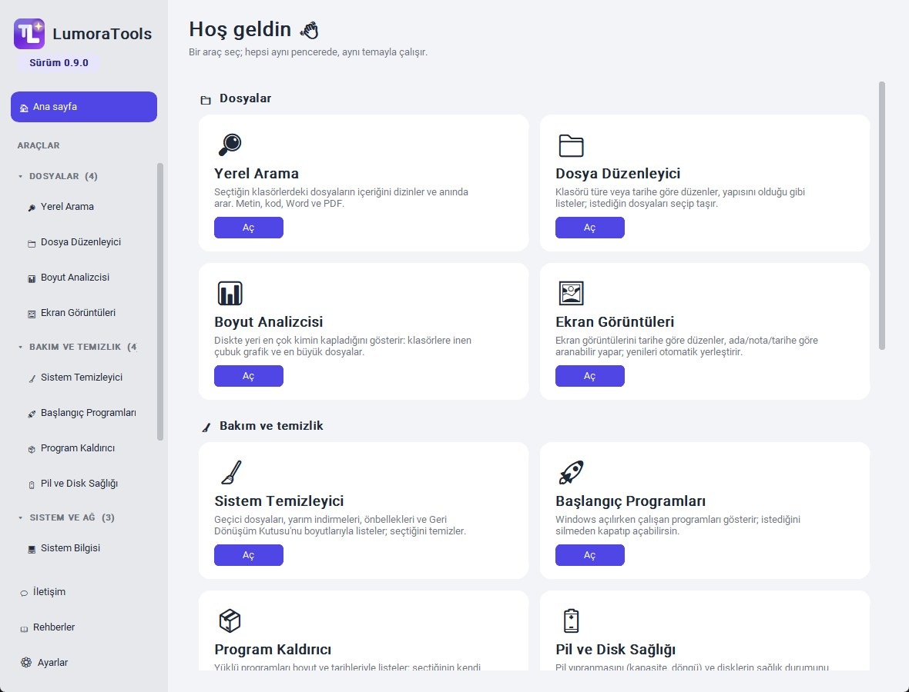

<div align="center">


# LumoraTools

A fully local toolkit for Windows that runs in a single window.

[Download latest release](../../releases/latest) · [Release notes](../../releases) · [Report a bug](../../issues)

[Türkçe](README.md) · English


</div>

<br>

<p align="center">
  
</p>

## Overview

LumoraTools brings everyday tasks such as file organization, content search, disk cleanup, system monitoring and task tracking into one desktop application. Every tool runs in the same window and shares the same theme and settings.

The application requires no account and sends no data anywhere. All settings and records are stored only on the user's computer. It ships as a single `.exe`, needs no installation, and updates itself from GitHub Releases.

The user interface is currently available in Turkish.

## Tools

Tools are grouped under four categories in the menu. Order and visibility can be changed in Settings.

### Files

| Tool | Description |
|---|---|
| Local Search | Indexes the contents of selected folders with SQLite FTS5 and searches them instantly. Supports plain text, source code, `.docx` and `.pdf`. Unchanged files are not re-read. |
| File Organizer | Sorts a folder into subfolders by extension, by date, or both. The destination of every file is shown in advance, and files can be selected individually or in bulk. Nothing is deleted and every operation can be undone. Watch mode places new files automatically. |
| Folder Size Analyzer | Shows the folders that take up the most space as proportional bars, with drill-down into subfolders. Also lists the largest files. |
| Screenshots | Organizes the screenshots folder by year and month and files new screenshots automatically. Provides search by name, note and date, plus a preview pane. |

### Maintenance

| Tool | Description |
|---|---|
| System Cleaner | Lists temporary files, crash dumps, partial downloads, browser caches and the Recycle Bin with their sizes, and cleans only what is selected. |
| Startup Programs | Lists programs that run at Windows startup. Entries are disabled without being deleted, using the same mechanism as Task Manager. |
| Uninstaller | Lists installed programs with size and install date. Removal is handled by each program's own uninstaller. |
| Battery and Disk Health | Shows battery wear (capacity relative to design, charge cycles) and the health status of each disk. |

### System and network

| Tool | Description |
|---|---|
| System Info | Displays CPU, memory, disk, network throughput and battery status with live charts. A hardware summary without computer or user name can be copied. |
| Process Manager | Lists running processes by memory and CPU usage and groups processes of the same program. Critical Windows processes cannot be terminated. |
| Network Tools | Shows active connections and listening ports together with the owning program. Provides ping, DNS lookup and single-port checks. |

### Productivity

| Tool | Description |
|---|---|
| Clipboard History | Keeps copied text, images and files. Offers search, pinning and date filters; recording can be paused at any time. |
| To-do | Task list with due dates and priorities, filtered by open, today, overdue and done. |
| Time Tracker | Reports how much time is spent in each program per day. Disabled by default. |

## Screenshots

<p align="center">
  
  
</p>
<p align="center">
  
  
</p>
<p align="center">
  
  
</p>

<p align="center"><sub>Screenshots were taken with sample data.</sub></p>

## Privacy and safety

- The application sends no user data to any server. Unless the user starts an action, the only network request is the update check, which can be disabled in Settings.
- Updates are downloaded over HTTPS only and are not applied unless the SHA-256 digest matches.
- File Organizer never deletes files, it only moves them. Existing files are never overwritten on name conflicts.
- System Cleaner works only in predefined folders and skips temporary files modified in the last 24 hours as well as symbolic links. Items that will be permanently deleted are listed explicitly in the confirmation dialog.
- Deleting screenshots or partial downloads moves them to the Recycle Bin.
- Time Tracker records only the program name and duration. Window titles, addresses and keystrokes are never recorded.
- Network Tools does not perform port scans and validates all input.

## Installation

1. Download `AracMerkezi.exe` from the [Releases](../../releases/latest) page.
2. Place it in any folder and run it. There is no installation step.

The executable is not code-signed, so Windows SmartScreen may show a warning on first launch. Choose "More info" and then "Run anyway" to continue.

Application data is stored in `%USERPROFILE%\.aracmerkezi`. A different location can be set with the `ARACMERKEZI_HOME` environment variable.

## Running from source

Requires Python 3.10 or later.

```bash
git clone https://github.com/highlvmami/LumoraTools.git
cd LumoraTools
py -m pip install -e .[dev]
py -m aracmerkezi
```

To run the tests and build the single-file executable:

```bash
py -m pytest
py build.py
```

`build.py` uses PyInstaller to produce `dist/AracMerkezi.exe` and the `dist/manifest.json` file used by the update check.

## Project structure

```
src/
  aracmerkezi/
    app.py           Main window, menu, settings and update flow
    registry.py      Tool registry, categories and discovery
    updater.py       Version check, download and verification
    themes.py        Theme definitions and contrast calculations
    ui.py            Shared UI components
    tools/           One package per tool
  duzenle/           File organization engine (planning, moving, undo)
tests/               pytest suite
build.py             PyInstaller build script
```

## Adding a tool

Each tool is a self-contained package under `src/aracmerkezi/tools/`. Its `__init__.py` defines a `ToolInfo` object: id, name, description, menu category, the function that builds its page and, if needed, functions that start and stop background work. The package name is added to `BUILTIN_TOOLS` in `registry.py` so that it is included in the single-file build.

## Contributing

Bug reports and suggestions are welcome in [Issues](../../issues). The Contact page inside the application also opens a pre-filled report form. For larger changes, please open an issue before sending a pull request.

## License

[MIT](LICENSE)
