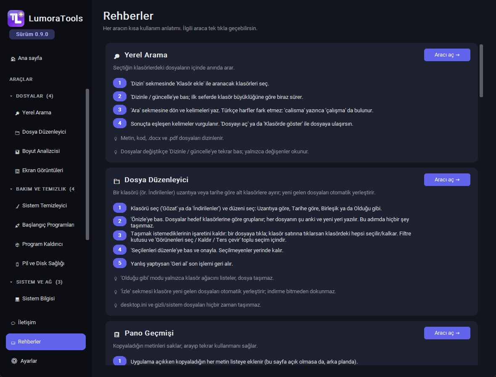
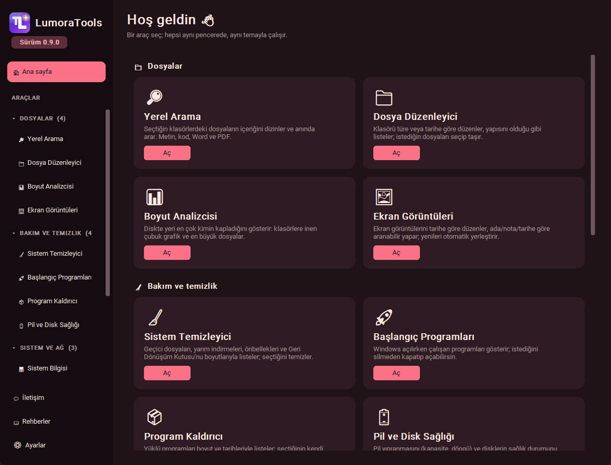

<div align="center">


# LumoraTools

**Tek pencerede 14 yerel Windows aracı: dosya düzenleme, arama, temizlik, sistem izleme, görevler ve daha fazlası. Tek `.exe`, otomatik güncelleme.**

**[İndir →](../../releases/latest)**

Türkçe · [English](README.en.md)

<p>
  
  
  
  
  
  
  
</p>

</div>

Küçük, işe yarayan araçlardan oluşan bir masaüstü seti. Soldaki menüden bir araç seçilir; hepsi aynı pencerede, aynı temayla çalışır. Her şey yerel çalışır: hesap yok, bulut yok, veriler yalnızca bu bilgisayarda durur. Arayüz Python + customtkinter ile yazıldı, uygulama tek bir `.exe` olarak dağıtılır ve açılışta GitHub Releases'tan kendini günceller.

> Kod imzalı olmadığı için Windows SmartScreen ilk açılışta uyarı gösterebilir.

## Ekran görüntüleri

<p align="center">
  
</p>

<p align="center">
  
  
</p>

<p align="center">
  
  
</p>

<p align="center">
  
  
</p>

<p align="center">
  
  
</p>

<p align="center"><sub>Ana sayfa · Dosya Düzenleyici · Boyut Analizcisi · Yapılacaklar · Sistem Bilgisi · Ayarlar · Rehberler · Gün Batımı ve Gündüz temaları. Görüntüler örnek verilerle çekildi.</sub></p>

## Araçlar

Menü dört kategoriye ayrılır; başlığa tıklayınca açılıp kapanır, ayarlardan düz listeye de dönülebilir.

| Kategori | Araçlar |
|---|---|
| 📁 **Dosyalar** | Yerel Arama · Dosya Düzenleyici · Boyut Analizcisi · Ekran Görüntüleri |
| 🧹 **Bakım ve temizlik** | Sistem Temizleyici · Başlangıç Programları · Program Kaldırıcı · Pil ve Disk Sağlığı |
| 🖥 **Sistem ve ağ** | Sistem Bilgisi · İşlem Yöneticisi · Ağ Araçları |
| ✍ **Üretkenlik** | Pano Geçmişi · Yapılacaklar · Zaman Takibi |

### Dosyalar
- **🔎 Yerel Arama:** seçtiğin klasörlerdeki dosyaların *içeriğinde* anında arar (SQLite FTS5). Metin, kod, `.docx` ve `.pdf` dizinlenir; değişmeyen dosyalar tekrar okunmaz. Eşleşen kelimeler vurgulanır, Türkçe harflere duyarsızdır.
- **📁 Dosya Düzenleyici:** bir klasörü (ör. İndirilenler) uzantıya, tarihe ya da ikisine göre alt klasörlere ayırır; "olduğu gibi" modu klasör yapısını ağaç olarak listeler. Önce önizlersin: hangi dosyanın nereye taşınacağı görünür, istediklerini tek tek ya da toplu seçersin. Dosyalar silinmez, yalnızca taşınır; aynı adlı dosya `ad (1).uzantı` olur ve her işlem **Geri al** ile geri alınır. **İzle** sekmesi yeni gelen dosyaları otomatik yerleştirir (inmekte olanlara dokunmaz).
- **📊 Boyut Analizcisi:** diskte yeri en çok kimin kapladığını çubuklarla gösterir, çubuğa tıklayınca klasörün içine girersin. "En büyük dosyalar" sekmesi tüm ağaçtaki en büyükleri sıralar. Hiçbir şey silmez.
- **🖼 Ekran Görüntüleri:** ekran görüntüleri klasörünü `Yıl\Ay` ya da `Yıl\Ay\Gün` düzenine koyar, yenileri otomatik yerleştirir. Ada, nota, klasöre ve tarihe göre ara; tarih filtresiyle daralt; önizle, not ekle. Ctrl/Shift ile çoklu seçip silebilirsin (silinenler Geri Dönüşüm Kutusu'na gider).

### Bakım ve temizlik
- **🧹 Sistem Temizleyici:** geçici dosyaları, çökme dökümlerini, yarım indirmeleri, tarayıcı/pip önbelleklerini ve Geri Dönüşüm Kutusu'nu boyutlarıyla listeler; yalnızca işaretlediğini temizler. Yalnızca tanımlı klasörlere dokunur, 1 günden yeni geçici dosyalara ve bağlantılara (junction/symlink) dokunmaz; yarım indirmeleri kalıcı silmek yerine Geri Dönüşüm Kutusu'na taşır. Onay penceresi neyin kalıcı silineceğini açıkça yazar.
- **🚀 Başlangıç Programları:** Windows açılırken çalışan programları (kayıt defteri ve Başlangıç klasörleri) listeler; silmeden kapatıp açabilirsin (Görev Yöneticisi'nin kullandığı StartupApproved işareti).
- **📦 Program Kaldırıcı:** yüklü programları boyut ve tarihleriyle listeler; kaldırmayı programın **kendi kaldırıcısı** yapar, araç hiçbir şeyi kendisi silmez.
- **🔋 Pil ve Disk Sağlığı:** pil yıpranması (kapasite oranı, şarj döngüsü) ve disklerin sağlık durumu. Ayrıntılı SMART bilgisi için yönetici izni gerekir.

### Sistem ve ağ
- **💻 Sistem Bilgisi:** işlemci, bellek, disk, ağ hızı ve pil durumu canlı grafiklerle; "Özeti kopyala" bilgisayar ve kullanıcı adını eklemeden paylaşılabilir bir özet verir.
- **📈 İşlem Yöneticisi:** bellek/işlemci kullanımına göre süreçler, aynı programı gruplama, korumalı sonlandırma: Windows'un kritik süreçleri ve uygulamanın kendisi sonlandırılamaz.
- **🌐 Ağ Araçları:** etkin bağlantılar ve dinleyen portlar (hangi program), ping, DNS sorgusu, tek `host:port` kontrolü. Port taraması yoktur, girdiler doğrulanır.

### Üretkenlik
- **📋 Pano Geçmişi:** kopyaladığın metin, görüntü ve dosyaları saklar; ara, sabitle, tarihe göre süz, çift tıklayıp tekrar panoya al. **Kaydediyor** anahtarı kaydı duraklatır (parola kopyalayacaksan kapat).
- **✅ Yapılacaklar:** son tarih, öncelik, süzgeç (Bekleyen / Bugün / Geciken / Biten) ve arama.
- **⏱ Zaman Takibi:** hangi programda ne kadar vakit geçtiğini günlük gösterir. **Varsayılan kapalıdır**; yalnızca program adı ve süre saklanır, pencere başlığı, adres ya da tuş vuruşu asla alınmaz.

### Uygulamanın kendisi
- **12 tema:** Gece, Gündüz, Okyanus, Orman, Gün Batımı, Kahve, Nord, Kömür, AMOLED, Lavanta, Şeker, Kağıt ve Windows'u izleyen "Sistem". Tüm renklerin okunabilirlik oranları testle doğrulanır.
- **Menü düzeni:** araçları sürükleyerek sırala, anahtarla gizle (gizlenen aracın arka plan işi de durur), kategorilere göre grupla ya da düz liste kullan.
- **Rehberler:** her aracın kısa kullanım anlatımı. **İletişim:** istek, hata ya da geri bildirimi, GitHub'da hazır doldurulmuş bir sayfa olarak açar; sen gönder demeden kimseye gitmez.
- **Yenilikler:** güncellemeden sonra ilk açılışta değişenleri gösterir.

## Kurulum

[Releases](../../releases/latest) sayfasından `AracMerkezi.exe` dosyasını indirip çalıştır. Kurulum gerekmez.

Uygulama açılışta yeni sürüm olup olmadığına bakar ve otomatik günceller (Ayarlar'dan kapatılabilir). Güncelleme yalnızca https üzerinden indirilir ve SHA-256 özeti doğrulanmadan uygulanmaz. Veriler `~/.aracmerkezi` klasöründe tutulur (`ARACMERKEZI_HOME` ortam değişkeniyle değiştirilebilir).

## Geliştirme

```bash
py -m pip install -e .[dev]
py -m aracmerkezi          # uygulamayı çalıştır
py -m pytest               # testler
py build.py                # dist/AracMerkezi.exe + dist/manifest.json
```

Testlerin bir kısmı gerçek pencere açar; test sırasında ekranda kısa süre pencereler görünebilir.

Yeni sürüm: `src/aracmerkezi/__init__.py` içindeki `__version__` değerini artır, `changelog.py`'ye notları ekle, `py build.py` çalıştır ve `dist/` içindeki iki dosyayı yeni bir GitHub sürümüne ekle.

## Proje yapısı

```
src/aracmerkezi/
  app.py             Ana pencere: kenar çubuğu, kategoriler, ayarlar, güncelleme şeridi
  registry.py        Araç kaydı (ToolInfo, Guide, kategoriler) ve araç keşfi
  themes.py, ui.py   12 tema ve ortak arayüz parçaları
  updater.py         GitHub Releases'tan güvenli güncelleme
  changelog.py       "Yenilikler" notları
  tools/             Her araç kendi paketinde: organizer, search, diskusage, screenshots,
                     cleaner, startup, uninstall, sysinfo, processes, network, health,
                     clipboard, todo, timetrack
src/duzenle/         Dosya düzenleme motoru (planlama, taşıma, geri alma)
tests/               330 test
```

## Yeni araç eklerken

1. `src/aracmerkezi/tools/` altında yeni bir paket aç; `__init__.py` içinde bir `GUIDE` ve `TOOL = ToolInfo(...)` tanımla (`category` ile menü kategorisini seç).
2. Sayfayı `build=lambda parent, hub: SayfaSinifi(parent, hub)` ile bağla; arka plan işi gerekiyorsa `start`/`stop` ver.
3. Paket adını `registry.py` içindeki `BUILTIN_TOOLS` listesine ekle (tek `.exe` derlemesi için gerekli).
4. Test yaz, `changelog.py`'ye not ekle.

## Geri bildirim

Öneri, hata bildirimi ve fikirlerin için uygulamadaki **İletişim** sayfasını ya da [Issues](../../issues) bölümünü kullanabilirsin.

Projeyi beğendiysen bir ⭐ bırakmayı unutma!
